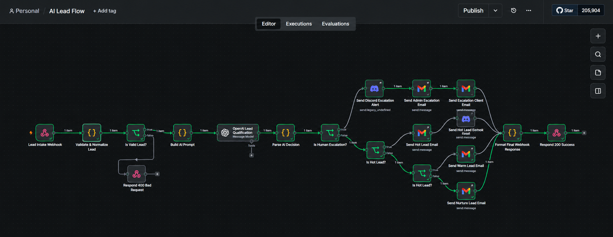
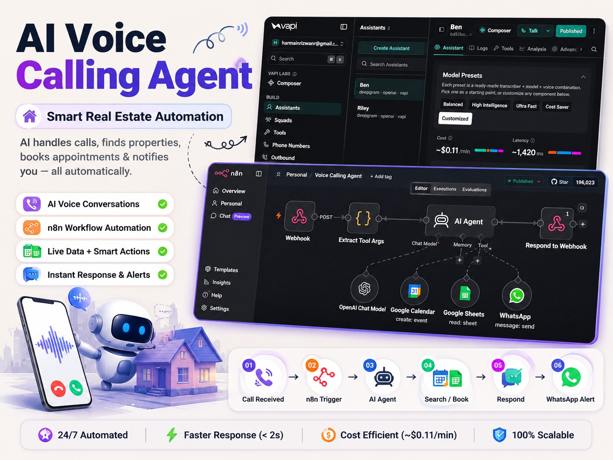
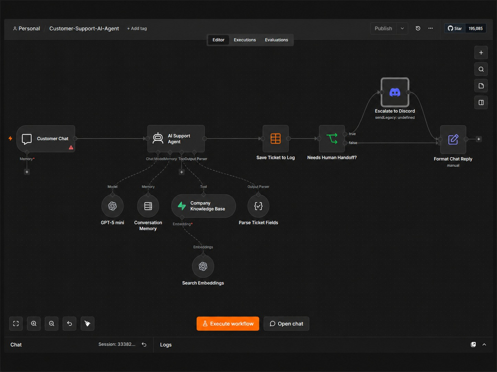
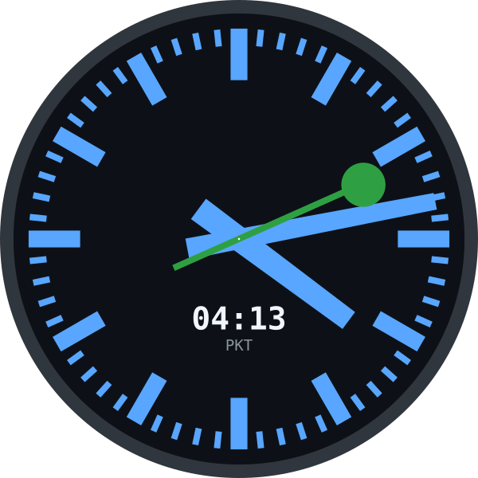

<h1 align="center">Hi! I am Harmain Rizwan 👋</h1>

<h3 align="center">AI Cloud Architect &amp; DevOps Engineer | Autonomous Agent Orchestration | Senior Full-Stack Developer</h3>

  
  
  
  
  
  

  

  

<h2 align="center">
  
  &nbsp;Ａｂｏｕｔ Ｍｅ&nbsp;
  
</h2>

  

I engineer **cloud-native infrastructure, autonomous AI agent pipelines, and resilient full-stack systems** that empower modern businesses to automate operations, scale seamlessly, and operate with high reliability in production. My work sits at the convergence of **DevOps automation, AI orchestration, cloud architectures, and robust backend engineering**.

- **DevOps & cloud infrastructure** — design, deploy, and manage production clusters on AWS and GCP using Docker, Kubernetes, Terraform, and Linux administration
- **CI/CD & release pipelines** — automate delivery with GitHub Actions, GitLab CI/CD, Jenkins, and containerized deployment workflows
- **AI agent orchestration** — architect autonomous multi-agent pipelines with n8n, LangChain, OpenAI GPT-4o, Make, and Zapier
- **Voice & conversational AI** — deploy real-time telephony agents using Vapi, Deepgram speech-to-text, and dynamic function calling
- **RAG & knowledge retrieval** — eliminate hallucinations with Supabase pgvector, document chunking, and semantic embeddings
- **Backend & APIs** — engineer high-throughput APIs and microservices with Python, FastAPI, PHP, Laravel, Node.js, and Express
- **Observability & reliability** — monitor distributed systems using Prometheus, Grafana, ELK, and container health checks
- **Full-stack web applications** — craft responsive, conversion-focused interfaces with React, Vue.js, TypeScript, and Tailwind CSS

I specialize in taking intricate business workflows and turning them into fault-tolerant, scalable systems that run 24/7 with zero human intervention.

  

  

[Portfolio](https://harmain.dev) · [Earlier Portfolio](https://portfolio-theta-ten-13.vercel.app/) · [LinkedIn](https://www.linkedin.com/in/harmain-rizwan-7a4328440/) · [Email](mailto:harmainrizwanr@gmail.com) · [GitHub](https://github.com/Harmain89) · [WhatsApp](https://wa.me/923182227655)

---

### 🚀 Languages - Frameworks - Tools - Libraries - Workspace 🚀

  

  
  
  
  
  
  
  
  
  
  
  
  
  
  
  
  

## Featured Projects

Hands-on AI automation, agentic workflows, voice telephony, and cloud systems covering DevOps, Kubernetes, CI/CD, n8n, Python, Laravel, and cloud architectures. Code links go to public GitHub repositories. Demos go to live deployments.

|                                                                                                                                                                                                                                                               |                                                                                                                                                                                                                                                            |
| ------------------------------------------------------------------------------------------------------------------------------------------------------------------------------------------------------------------------------------------------------------- | ---------------------------------------------------------------------------------------------------------------------------------------------------------------------------------------------------------------------------------------------------------- |
|  [AI Lead Flow: Qualification & Routing →](https://github.com/Harmain89/AI-Lead-Flow) Production n8n pipeline with OpenAI reasoning, instant scoring, Discord alerts, and multi-tier email follow-ups. [Live Demo](https://ai-lead-gen-coral.vercel.app/) |  [AI Voice Calling Agent: Real Estate Telephony →](https://github.com/Harmain89/ai-voice-calling-agent-n8n) Autonomous telephony with Vapi, Deepgram STT, and OpenAI LLM querying live property listings, booking viewings on Google Calendar, and WhatsApp alerts. |
|  [AI Customer Support Agent: RAG Knowledge Base →](https://github.com/Harmain89/AI-Customer-Support) Zero-hallucination support agent grounded in company docs via GPT-4o mini and Supabase pgvector semantic search, with human-in-the-loop Discord escalation. |  [Enterprise Full-Stack & SaaS Platforms →](https://harmain.dev/#projects) Production web platforms including WeDissect (KYC SaaS), Background Removal AI, In The Hair Salon, and HairColorDrop built on Laravel, MERN, and GCP. |

| Project | Focus | Links |
| -------------------------------- | ------------------------------------------------------------------------------------------------------------------------------------------------------------------------------------------------ | ----------------------------------------------------------------------------------------------------------------------------------------------------------------------------------------- |
| AI Lead Flow | Ingests leads via webhooks, normalizes payloads, evaluates quality with OpenAI reasoning, and executes multi-tier automated routing | [Code](https://github.com/Harmain89/AI-Lead-Flow) · [Live Demo](https://ai-lead-gen-coral.vercel.app/) |
| AI Voice Calling Agent | Real-time autonomous telephony using Vapi, Deepgram, and OpenAI to query live property sheets, schedule tours, and send alerts | [Code](https://github.com/Harmain89/ai-voice-calling-agent-n8n) · [Case Study](https://harmain.dev/#projects) |
| AI Customer Support Agent | Documentation-grounded RAG support system using Supabase pgvector, conversation memory, ticket logging, and Discord escalation | [Code](https://github.com/Harmain89/AI-Customer-Support) · [Case Study](https://harmain.dev/#projects) |
| Web Scraping & Data Structuring | Python & BeautifulSoup ETL pipeline orchestrated via n8n for automated change detection, normalization, and CRM sync | [Code](https://github.com/Harmain89/Web-Scraping-and-Data-Structuring-System) · [Case Study](https://harmain.dev/#projects) |
| Appointment Booking & Follow-up | Zero-touch appointment lifecycle handling scheduling, real-time availability checks, cancellations, and multi-channel follow-ups | [Code](https://github.com/Harmain89/appointment-booking-follow-up-system) · [Case Study](https://harmain.dev/#projects) |
| Trendwire AI SEO Blog Engine | Automated technology story discovery, GPT-4 article generation, image synthesis, and automated publishing to full-stack blog | [Code](https://github.com/Harmain89/AI-SEO-Blog-Generation-n8n) · [Case Study](https://harmain.dev/#projects) |
| MERN Authentication System | Full-stack authentication with JWT, bcrypt password hashing, email verification, OTP validation, and Brevo delivery | [Code](https://github.com/Harmain89/MernAuth) · [Case Study](https://harmain.dev/#projects) |
| YouTube Videos Manager | Backend application for categorizing, managing, searching, and previewing personalized video libraries | [Code](https://github.com/Harmain89/youtubeManager) · [Case Study](https://harmain.dev/#projects) |

### Selected Full-Stack Products

| Product | Focus | Stack |
| --- | --- | --- |
| [WeDissect](https://www.wedissect.com/) | KYC SaaS, identity verification, background screening, risk insights, real-time lookups, and forensic document analysis | Laravel · MySQL · Node.js · Express · GCP |
| [Background Removal](https://background-removal-liart.vercel.app/) | AI-powered image background removal web application with instant processing | React · MongoDB · Express · Clerk · Clipdrop API |
| [In The Hair Salon](https://inthehairsalon.com/saloon/) | Premium Dubai salon platform with service discovery and online appointment booking | Laravel · MySQL |
| [HairColorDrop](https://haircolordrop.com/) | Virtual hair color consultations, custom kit formulation, and 24h doorstep delivery platform | Laravel · MySQL |
| [RestNCode](https://restncode.net/) | Modern digital solutions agency platform delivering scalable web and backend applications | Laravel · MySQL |

<h2 align="center">💼 Experience</h2>

| Role | Organization | Period |
| --- | --- | --- |
| Senior Full-Stack Developer | Softosync | Jan 2024 – Present |
| Mid Full-Stack Developer | Quick4Solutions | Jan 2022 – Jun 2023 |
| Junior Backend Developer | Softologics | Earlier |

My work focuses on architecting production Laravel and MERN applications, high-performance Python microservices, database tuning, API gateways, autonomous workflow pipelines, and continuous integration workflows.

## 📊 My Github Stats

<h3 align="center">
  
  
  【Ｓｔａｔｓ】
</h3>

  

  

  
  

  
📈 More Stats

   

  

    
      
    
      
    
  

  

  

  <a href="https://github.com/Harmain89">
    <picture>
      <source media="(prefers-color-scheme: dark)" srcset="https://raw.githubusercontent.com/Harmain89/Harmain89/output/github-snake-dark.svg">
      <source media="(prefers-color-scheme: light)" srcset="https://raw.githubusercontent.com/Harmain89/Harmain89/output/github-snake.svg">
      
    </picture>
  </a>

  <a href="https://github.com/Harmain89">
    <picture>
      <source media="(prefers-color-scheme: dark)" srcset="https://raw.githubusercontent.com/Harmain89/Harmain89/output/pacman-contribution-graph-dark.svg">
      <source media="(prefers-color-scheme: light)" srcset="https://raw.githubusercontent.com/Harmain89/Harmain89/output/pacman-contribution-graph.svg">
      
    </picture>
  </a>

 
 

  ⏳ 𝚈𝚘𝚞 𝚑𝚊𝚟𝚎 𝚜𝚝𝚊𝚢𝚎𝚍 𝚘𝚗 𝚖𝚢 𝚙𝚛𝚘𝚏𝚒𝚕𝚎 𝚏𝚘𝚛 ◔_◔ ⌛

  
  &nbsp;&nbsp;
  

  

  

  

